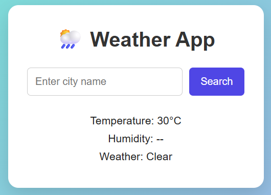

# 🌦️ Weather App

A simple **Weather App** built using **HTML, CSS, and JavaScript**. It allows users to search for a city and view its current temperature, humidity, and weather condition.

🌐 [**Live Demo**](https://sunny1901kumar-sys.github.io/Weather-App/)

## 📸 Screenshot



## ✨ Features

- 🔍 Search weather by city name
- 🌡️ Displays current temperature
- 💧 Displays humidity
- ☁️ Displays current weather condition
- ⏳ Shows a loading message while fetching weather data
- 🚫 Prevents searching with an empty input
- ❌ Shows an error when the city is not found
- ⚠️ Handles API and network errors
- 🧹 Removes extra spaces from the city input
- 🔄 Updates weather information dynamically based on the searched city


## 🛠️ Technologies Used

- **HTML** – Structure
- **CSS** – Styling and layout
- **JavaScript** – Weather logic and user interactions
- **Fetch API** – Fetching data from APIs
- **Open-Meteo API** – Geocoding and weather data


## 🚀 How to Run

1. Clone the repository.
2. Open the project folder in VS Code.
3. Open `index.html` in your browser.


## 🎯 What I Learned

- JavaScript DOM manipulation
- Using `querySelector()` and `querySelectorAll()`
- Adding event listeners
- Getting user input using `.value`
- Using `trim()` to clean user input
- Fetching data from APIs using `fetch()`
- Understanding Promises
- Using `async/await`
- Converting API responses using `response.json()`
- Working with JSON data
- Using latitude and longitude to fetch weather data
- Using `try...catch` for error handling
- Handling loading and error states
- Updating webpage content dynamically
- Creating a function to convert weather codes into weather descriptions


## 🔄 How It Works

```text
City Name
   ↓
Geocoding API
   ↓
Latitude + Longitude
   ↓
Weather API
   ↓
Temperature + Humidity + Weather Code
   ↓
Weather Description
   ↓
Display Data on Screen
```


## 👤 Author

**Sunny Kumar**

- GitHub: [https://github.com/sunny1901kumar-sys](https://github.com/sunny1901kumar-sys)
- LinkedIn: [https://www.linkedin.com/in/sunny-kumar9540](https://www.linkedin.com/in/sunny-kumar9540)